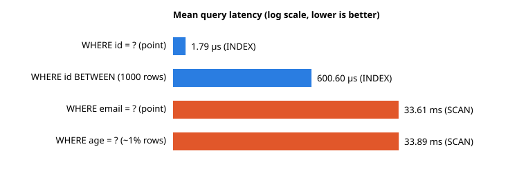

# mini-dbms

C++17 로 밑바닥부터 구현한 미니 DBMS. 외부 라이브러리 없이 표준 라이브러리와 POSIX 소켓만 사용합니다.

| Phase | 내용 | 핵심 결과물 |
|---|---|---|
| 1 | SQL 처리기 | `INSERT`/`SELECT` 를 파싱·실행하고 파일에 저장하는 CLI (`minidb`) |
| 2 | B+ 트리 인덱스 | `WHERE id` 를 B+ 트리로 처리, 100만 건 성능 비교 |
| 3 | API 서버 | Thread Pool 기반 HTTP API (`minidb_server`), 테이블 단위 RW 락 |

## 빌드와 실행

```bash
make            # build/ 에 minidb, minidb_server, bench, tests 생성
make test       # 단위 테스트 + CLI/서버 기능 테스트
make tsan       # ThreadSanitizer 로 전체 테스트(동시성 포함) 실행
make bench      # 100만 건 벤치마크 -> docs/benchmark.md, docs/benchmark.svg, bench/results.csv
```

### CLI

```bash
./build/minidb --data-dir data -e "INSERT INTO users (name, age, email) VALUES ('kim', 30, 'k@x.com');"
./build/minidb --data-dir data -e "SELECT name FROM users WHERE id = 1;"
./build/minidb --data-dir data --file query.sql      # SQL 텍스트 파일
echo "SELECT * FROM users LIMIT 5;" | ./build/minidb --data-dir data
```

SELECT 결과 아래에 `plan=INDEX`(B+ 트리 사용) 또는 `plan=SCAN`(선형 탐색)이 표시됩니다.

### API 서버

```bash
./build/minidb_server --data-dir data --port 8080 --threads 8 --max-queue 256
curl -X POST localhost:8080/query -d "SELECT * FROM users WHERE id = 1"
curl -X POST localhost:8080/query -H 'Content-Type: application/json' -d '{"sql":"SELECT * FROM users LIMIT 3"}'
curl localhost:8080/health
```

응답 예:

```json
{"ok":true,"results":[{"kind":"SELECT","columns":["id","name"],"rows":[[2,"lee"]],"plan":"INDEX","count":1}],"elapsed_ms":0.021}
{"ok":false,"error":"table 'nope' does not exist","results":[],"elapsed_ms":0.0}
```

| 상태 | 의미 |
|---|---|
| 200 | 성공 |
| 400 | SQL 문법/검증 오류, 잘못된 HTTP 요청 |
| 404 | 없는 테이블 또는 경로 |
| 405 / 413 / 431 / 408 | 메서드 불일치 / 본문 과대(기본 1MiB) / 헤더 과대 / 읽기 타임아웃(5초) |
| 503 | 작업 큐 포화 (backpressure) |
| 500 | 저장소 I/O 등 서버 오류 |

## 지원 SQL

```sql
INSERT INTO users (name, age, email) VALUES ('kim', 30, 'k@x.com'), ('lee', 25, 'l@x.com');
INSERT INTO users VALUES ('park', 41, 'p@x.com');         -- id 를 제외한 전체 컬럼, 스키마 순서
SELECT * FROM users;
SELECT name, age FROM users WHERE age >= 20 AND name != 'x' LIMIT 10;
SELECT * FROM users WHERE id BETWEEN 100 AND 200;
```

- 연산자: `= != <> < <= > >=`, `BETWEEN a AND b`, 조건은 `AND` 로만 결합. 키워드 대소문자 무시, `--` 주석, `'it''s'` 이스케이프.
- 세미콜론으로 여러 문장을 한 번에 실행할 수 있습니다.
- 테이블은 `data/<table>/schema.json` 으로 미리 정의합니다 (`CREATE TABLE` 은 범위 밖).

```json
{"table":"users","columns":[{"name":"id","type":"BIGINT"},{"name":"name","type":"VARCHAR(50)"},
                            {"name":"age","type":"INT"},{"name":"email","type":"VARCHAR(100)"}]}
```

타입: `INT`, `BIGINT`, `DOUBLE`, `VARCHAR(n)` (n 은 바이트). 첫 컬럼은 항상 `id BIGINT`, 자동 부여됩니다.

## 구조

```
SQL ──▶ Lexer ──▶ Parser(AST) ──▶ Engine::execute ──▶ Table ──▶ HeapFile (data.bin, append-only)
                                                        └────▶ BPlusTree (id -> 파일 offset, 메모리)

HTTP 요청 ──▶ acceptor 스레드 ──▶ [유한 작업 큐] ──▶ Worker × N ──▶ Engine::execute  (CLI 와 동일 경로)
                                  └─ 가득 차면 503
```

```
src/common   Result<T>, Value, 최소 JSON
src/sql      lexer, parser, AST
src/storage  schema.json 로더, 레코드 직렬화, append-only 힙 파일
src/index    B+ 트리 (템플릿, 헤더 전용)
src/engine   Engine(테이블 맵), Table(락 + 힙 + 인덱스)
src/server   ThreadPool, HTTP 파서, 서버, 응답 JSON
src/cli      minidb, minidb_server
```

### 저장 포맷
`data.bin` 은 `[u32 길이][payload]` 레코드를 이어 붙인 파일이고 payload 는 컬럼 순서대로 직렬화됩니다
(INT/BIGINT/DOUBLE = 8바이트, VARCHAR = u32 길이 + 바이트). 레코드의 위치는 파일 offset 입니다.
시작할 때 파일을 한 번 훑어 `next_id` 를 복원하고 B+ 트리를 다시 만들며, 쓰다 만 꼬리 레코드는 잘라냅니다.

### B+ 트리 (`src/index/bplus_tree.h`)
- 값은 리프에만 있고 리프끼리 `next` 로 연결되어 범위 스캔이 가능합니다. 노드당 최대 128 키.
- 리프 분할은 분리 키를 부모로 **복사**, 내부 노드 분할은 가운데 키를 부모로 **이동**합니다. 루트가 분할되면 높이가 1 늘어납니다.
- `validate()` 가 정렬, 분리 키 범위, 모든 리프의 동일 깊이, 최소 점유율, 리프 체인, 크기를 검사합니다.
- 질의 계획: `WHERE` 의 id 정수 비교(`= < <= > >= BETWEEN`)를 하나의 `[lo, hi]` 범위로 합쳐 인덱스를 탑니다.
  `!=` 나 실수 리터럴(`id > 5.0`)은 인덱스를 쓰지 않고 필터로만 평가합니다.

### 동시성 (`src/engine/table.cpp`)
- 테이블마다 `std::shared_mutex` 하나: `SELECT` 는 shared, `INSERT` 는 unique.
- `INSERT` 는 id 발급 → 힙 append → 인덱스 갱신을 **하나의 배타 락 구간**에서 처리하므로 id 가 중복·누락되지 않고, 읽기 쪽은 인덱스와 힙이 어긋난 상태를 볼 수 없습니다.
- 여러 행 INSERT 는 전체가 성공하거나 전체가 실패합니다 (검증은 락 밖, 쓰기는 한 번의 write).
- 서버는 락을 잡지 않으며, 소켓 I/O 는 엔진 실행이 끝난 뒤에만 합니다. 느린 클라이언트는 소켓 타임아웃으로 워커를 오래 점유하지 못합니다.

## 벤치마크 (100만 건, 실측)

`make bench` 로 재현합니다. 전체 표와 방법은 [docs/benchmark.md](docs/benchmark.md), 그래프는 [docs/benchmark.svg](docs/benchmark.svg).



| 쿼리 | 계획 | 평균 지연 |
|---|---|---|
| `WHERE id = ?` | INDEX | 4.38 µs |
| `WHERE id BETWEEN` (1000행) | INDEX | 1.23 ms |
| `WHERE email = ?` | SCAN | 70.59 ms |

id 인덱스 점 조회가 비인덱스 선형 탐색보다 약 16,100배 빨랐습니다 (이 실행 기준. 머신 부하에 따라 실행마다 크게 변동하며 이전 실행에서는 약 18,800배).
삽입은 SQL 경로 0.83 s, 벌크 경로 0.28 s (각 100만 행). 측정 환경: Apple Silicon, OS 페이지 캐시 warm 상태.

## 테스트

- 단위: lexer/parser, JSON, schema, 레코드, 힙 파일(청크 경계·찢어진 꼬리·손상), B+ 트리(차수 3/4/5/64, 오름·내림·랜덤, `std::map` 대조), ThreadPool, HTTP 파서
- 기능: SQL 엔드투엔드, 인덱스 결과 = 선형 탐색 결과, 재시작 복구, CLI(`-e`/`--file`/stdin/종료 코드), 실제 서버 프로세스 + curl
- 동시성: 다중 스레드 INSERT 후 id 유일·연속·인덱스 일치, 읽기/쓰기 혼합, 소켓 클라이언트 16개 동시 요청, 큐 포화 503, 느린 클라이언트 408, graceful shutdown
- `make tsan` (ThreadSanitizer) 에서 데이터 레이스 0건

## 설계상 한계 (의도된 단순화)

- `NULL`, `UPDATE`, `DELETE`, `OR`, 조인, 집계는 지원하지 않습니다. INSERT 는 id 를 제외한 모든 컬럼을 지정해야 합니다.
- 여러 문장 스크립트는 트랜잭션이 아닙니다: 중간 문장이 실패하면 앞 문장의 효과는 남습니다 (단일 INSERT 문은 원자적).
- 내구성: INSERT 는 `write` 만 하고 `fsync` 는 하지 않습니다. 프로세스 크래시에는 안전하지만 OS 크래시 시 마지막 쓰기를 잃을 수 있습니다.
- 레코드는 리틀엔디안 호스트를 가정하고 memcpy 로 직렬화합니다.
- 인덱스는 메모리 상주이고 시작 시 재구축합니다. 서버는 `Connection: close` 단일 요청 모델입니다 (keep-alive 없음).
- 타임아웃은 recv/send 호출 단위(5초)라, 바이트를 아주 천천히 계속 보내는 slowloris 형 클라이언트는 워커를 오래 점유할 수 있습니다 (요청 전체 데드라인 없음).
