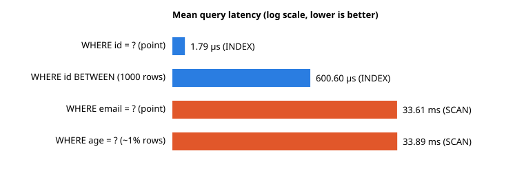

# Benchmark Report

> 이 파일은 `make bench` 가 자동 생성합니다. 모든 수치는 해당 실행의 실측값입니다.

- 실행 시각: 2026-11-16 22:28
- 레코드 수: 1000000 (테이블당)
- 하드웨어 스레드: 10
- 스키마: id BIGINT, name VARCHAR(32), age INT, email VARCHAR(64)
- B+ 트리: 노드당 최대 128 키, 키=id, 값=data.bin offset
- 데이터 파일 크기: 55 MiB

## 삽입 (1000000 rows)

| 경로 | 소요 시간 | 처리량 |
|---|---|---|
| SQL (1000행 INSERT 문 반복) | 0.43 s | 2317451 rows/s |
| 벌크 (Table::insert, 10000행 배치) | 0.14 s | 7258422 rows/s |

## 조회

| 쿼리 | 실행 계획 | 횟수 | 평균 | p50 | p99 | 최대 |
|---|---|---|---|---|---|---|
| `WHERE id = ? (point)` | INDEX | 10000 | 1.79 µs | 1.75 µs | 2.50 µs | 14.75 µs |
| `WHERE id BETWEEN (1000 rows)` | INDEX | 1000 | 600.60 µs | 603.96 µs | 663.50 µs | 709.17 µs |
| `WHERE email = ? (point)` | SCAN | 20 | 33.61 ms | 33.72 ms | 37.36 ms | 37.36 ms |
| `WHERE age = ? (~1% rows)` | SCAN | 5 | 33.89 ms | 33.90 ms | 34.52 ms | 34.52 ms |

**ID 인덱스 점 조회는 비인덱스(email) 선형 탐색보다 평균 약 18802배 빠르다.**

## 측정 방법

- 모든 쿼리는 `Engine::execute()`(파싱 포함)로 실행하며 지연시간은 파싱+실행+결과 구성을 포함한다.
- 점 조회 대상 id/email 은 고정 시드 난수로 선택한다. 각 쿼리는 결과 행 수와 실행 계획(INDEX/SCAN)을 검증한다.
- 같은 행을 id(인덱스)와 email(선형 탐색)로 각각 조회해 결과가 동일한지 20회 교차 검증했다.
- 삽입 후 `Table::verify_index()` 로 B+ 트리 불변식과 힙 파일 offset 일치를 검증했다.
- 캐시: OS 페이지 캐시에 올라간 상태(warm)에서의 측정이다. 인덱스는 메모리 상주.
- 재현: `make bench` (행 수 변경: `./build/bench --rows N`).
